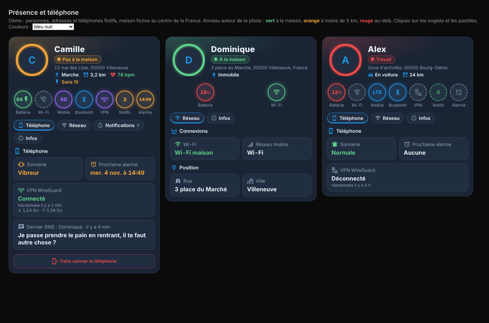

## Carte Présence et téléphone 1.1.0 : nouveau design « profil »

🎮 **[Essayer la démo en ligne](https://marlboro62.github.io/tracker/docs/demo.html)** : trois personnes fictives (à la maison, près de la maison, loin), sans installer Home Assistant.

### Nouveautés

- **Anneau de présence** autour de la photo (ou de l'initiale) :
  - 🟢 **vert** à la maison ;
  - 🟠 **orange** près de la maison (5 km par défaut) ;
  - 🔴 **rouge** au-delà.

  La pastille de zone et un halo de fond prennent la même couleur. La distance est calculée par la carte, entre le GPS du téléphone et la zone Maison.
- **Option `near_radius`** (5 km par défaut) : distance jusqu'à laquelle l'anneau reste orange, réglable dans l'éditeur visuel.
- **Identité mise en avant** : nom en grand, zone, adresse, puis activité, distance de la maison, fréquence cardiaque et type de chargeur.
- **Pastilles rondes** sous la photo, pour l'état d'un coup d'œil : **batterie** (pourcentage, couleur selon le niveau, éclair de charge), **Wi-Fi**, **réseau mobile** (4G, 5G…), **Bluetooth**, **VPN**, **notifications** et **prochaine alarme**. Allumées quand c'est actif, en pointillés quand c'est coupé ; un clic ouvre le détail, ou l'onglet Notifications.
- L'onglet **Téléphone** garde le détail : sonnerie, prochaine alarme avec la date, VPN WireGuard (handshake, données reçues et envoyées), dernier SMS, bouton **Faire sonner le téléphone**.
- **Démo en ligne** sur GitHub Pages.

### Mise à jour

Aucune configuration à changer : les options et le type `custom:tracker-card` restent les mêmes qu'en 1.0.0.

HACS → **Carte Présence et téléphone** → ⋮ → **Mettre à jour les informations**, installez la 1.1.0, puis Ctrl+F5.

Questions et bugs : uniquement via les [Issues GitHub](https://github.com/Marlboro62/tracker/issues).
