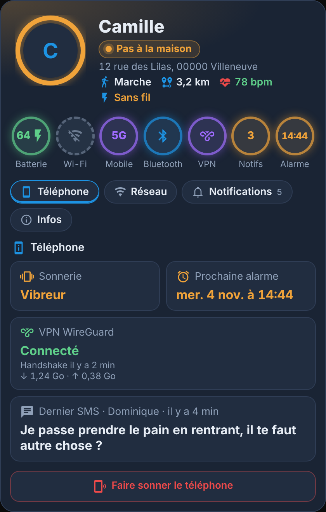
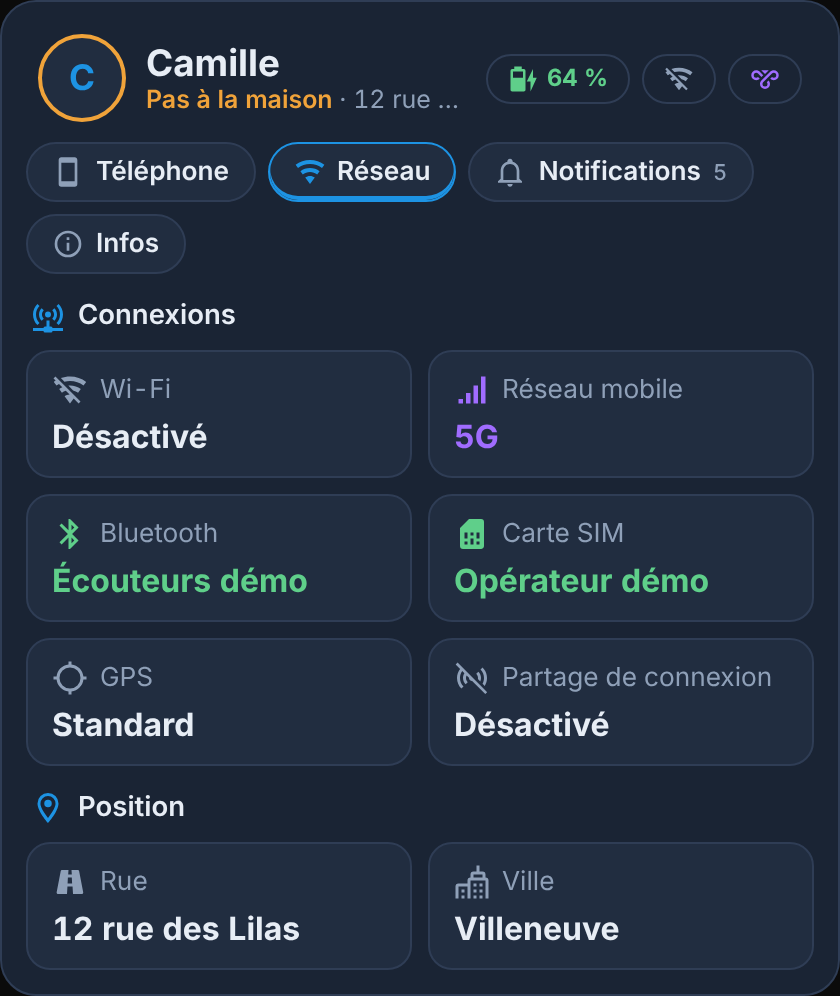
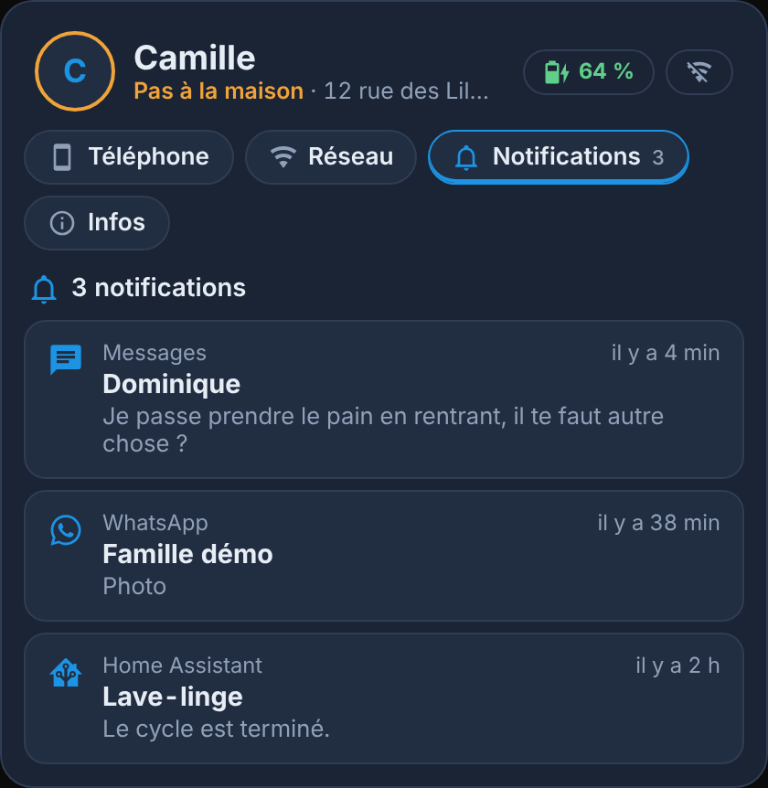
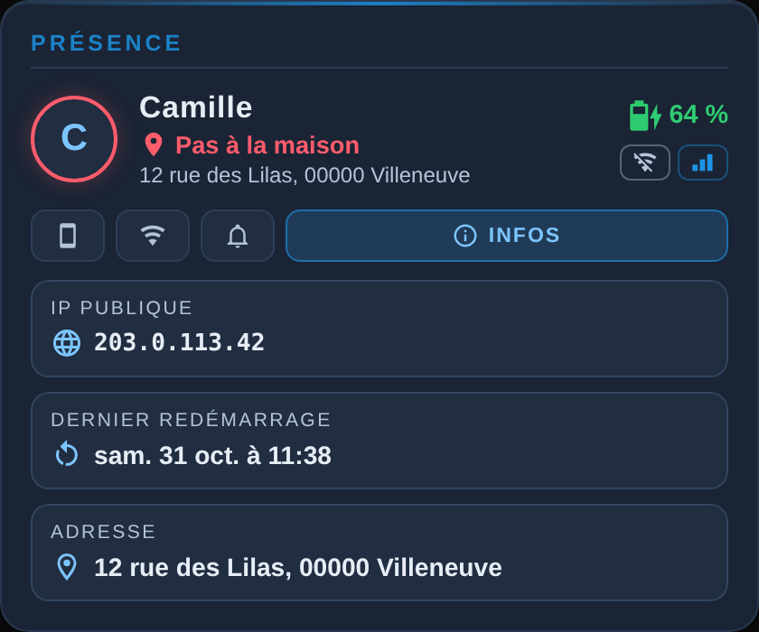
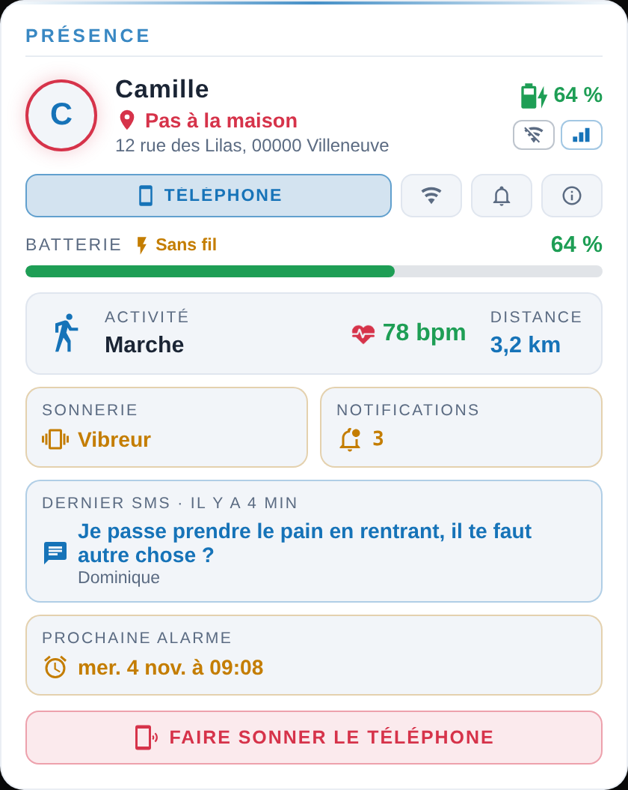

<p>
  ☕ <strong>Si cette carte vous est utile, vous pouvez soutenir le projet :</strong>
</p>

<div style="white-space: nowrap; line-height: 0;">
  <a
    href="https://www.buymeacoffee.com/Marlboro62"
    target="_blank"
    rel="noopener noreferrer"
    style="display: inline-block; text-decoration: none; vertical-align: middle;"
  ></a>&nbsp;&nbsp;<a
    href="https://ko-fi.com/M4M2QL45X"
    target="_blank"
    rel="noopener noreferrer"
    style="display: inline-block; text-decoration: none; vertical-align: middle;"
  ></a>
</div>


# Carte Présence et téléphone

[](https://hacs.xyz/)
[](https://github.com/Marlboro62/tracker/releases)

Une carte Lovelace pour Home Assistant qui montre **où est une personne** et **l'état de son téléphone** : batterie et charge, activité, distance de la maison, sonnerie, notifications (avec leur contenu et le dernier SMS), VPN WireGuard, prochaine alarme, Wi-Fi, réseau mobile, Bluetooth, carte SIM, GPS, adresse, IP publique. Tout est **en français**.

Il suffit de choisir la personne : la carte **trouve toute seule les capteurs de son téléphone** (application compagnon Home Assistant, Android ou iPhone). Aucun YAML à écrire, aucune intégration en plus.

| Téléphone | Réseau | Notifications |
|---|---|---|
|  |  |  |

| Infos | Clair |
|---|---|
|  |  |

*Captures réalisées en mode démo : personne, adresse et téléphone fictifs.*

🎮 **[Essayer la démo en ligne](https://marlboro62.github.io/tracker/docs/demo.html)** : la vraie carte avec trois personnes fictives (à la maison, près de la maison, loin), sans installer Home Assistant.

**En-tête « profil »** : la photo (ou l'initiale) est entourée d'un **anneau de présence** : **vert** à la maison, **orange** près de la maison (5 km par défaut, option `near_radius`), **rouge** au-delà. La pastille de zone et le halo de fond prennent la même couleur. À côté : le nom, l'adresse, l'activité, la distance de la maison et la fréquence cardiaque. En dessous, une rangée de **pastilles rondes** donne l'état d'un coup d'œil : batterie (avec l'éclair de charge), Wi-Fi, réseau mobile (4G, 5G…), Bluetooth, VPN, nombre de notifications et heure de la prochaine alarme ; une pastille en pointillés signale ce qui est coupé.

## Installation

### Avec HACS (recommandé)

1. Dans HACS, cherchez **Carte Présence et téléphone** et installez-la.
2. Rechargez la page (Ctrl+F5).

Si la carte n'apparaît pas encore dans la recherche de HACS, ajoutez le dépôt à la main : menu **⋮** → **Dépôts personnalisés**, adresse `https://github.com/Marlboro62/tracker`, type **Tableau de bord** (Dashboard), puis cherchez **Carte Présence et téléphone**.

### Manuelle

Copiez `tracker-card.js` dans `/config/www/`, puis ajoutez la ressource `/local/tracker-card.js` (type **Module JavaScript**) dans **Paramètres → Tableaux de bord → ⋮ → Ressources**.

## Configuration

Le plus simple : **Modifier le tableau de bord → Ajouter une carte → Présence et téléphone**, puis choisissez la personne. Ou en YAML :

```yaml
type: custom:tracker-card
person: person.camille
```

C'est tout : le suivi de position de la personne mène à son téléphone, et la carte prend les capteurs de l'application compagnon de cet appareil. Les tuiles sans capteur ne s'affichent pas, un onglet vide non plus.

### Options

| Option | Description | Défaut |
|---|---|---|
| `person` | La personne suivie (`person.…`) | — |
| `name` | Nom affiché | celui de la personne |
| `picture` | Photo (adresse d'une image) | celle de la personne |
| `title` | Titre de la carte (vide : le nom de la personne) | — |
| `theme` | `v2` bleu nuit, `auto` clair ou sombre selon Home Assistant, `ha` couleurs du thème Home Assistant | `v2` |
| `find_phone_script` | Script ou bouton qui fait sonner le téléphone : affiche le bouton **Faire sonner le téléphone** | — |
| `find_phone_data` | Données passées au script, pour **un seul script commun à plusieurs téléphones** (voir plus bas) | — |
| `places` | **Lieux** de l'onglet Infos : zones ou capteurs de distance (voir plus bas) ; `false` pour les masquer | toutes les zones |
| `places_max` | Nombre de lieux affichés au plus | `8` |
| `places_sort` | Ordre des lieux : `list` (ordre de `places`) ou `distance` (du plus proche au plus loin). Les zones trouvées seules sont toujours triées par distance | `list` |
| `places_hide_current` | Masquer la zone où se trouve la personne (elle est déjà dans l'en-tête) | `true` |
| `places_at_home` | Afficher la section Lieux quand la personne est à la maison | `true` |
| `approach_distance` | **Près de** / **En approche de** un lieu dans l'en-tête, en mètres du bord de la zone ; `0` pour désactiver | `150` |
| `show_since` | **Ici depuis** (ou **Parti depuis**) dans l'en-tête | `true` |
| `travel_times` | **Temps de trajet** de l'onglet Infos : capteurs Waze ou Google (voir plus bas) ; `false` pour les masquer | ceux trouvés |
| `near_radius` | Rayon « près de la maison » en km : anneau orange jusqu'à cette distance, rouge au-delà | `5` |
| `heart_rate` | Capteur de fréquence cardiaque (montre), affiché à côté de l'activité | — |
| `notifications` | `false` : ne pas afficher le contenu des notifications (onglet Notifications et dernier SMS) | `true` |
| `system_notifications` | `false` : ne pas lister les notifications du système (Android, constructeur, services Google) | `true` |
| `notifications_max` | Nombre de notifications listées au plus, par section | `20` |
| `demo` | `true` : personne et téléphone fictifs, pour partager une capture sans rien dévoiler | `false` |
| `phone` | Entités du téléphone à utiliser à la place de celles trouvées automatiquement (voir ci-dessous) | — |

### Capteurs du téléphone

Activez-les dans l'application compagnon (**Paramètres → Application compagnon → Gérer les capteurs**). Sur iPhone, iOS ne donne pas la sonnerie, l'alarme, le Bluetooth ni les notifications : la carte affiche à la place la concentration et l'activité du jour. La carte reconnaît les capteurs à la fin de leur identifiant :

| Clé sous `phone:` | Capteur de l'application compagnon | Affichage |
|---|---|---|
| `battery` | `…_battery_level` | Pastille Batterie |
| `charging` / `battery_state` | `…_is_charging` (Android) / `…_battery_state` (iPhone) | En charge |
| `charger_type` | `…_charger_type` | Secteur, USB, sans fil |
| `activity` | `…_detected_activity` (Android) / `…_activity` (iPhone) | Activité |
| `ringer` | `…_ringer_mode` | Sonnerie |
| `notif_count` | `…_active_notification_count` | Notifications |
| `next_alarm` | `…_next_alarm` | Prochaine alarme (en rouge dans l'heure qui vient) |
| `network_type` | `…_network_type` / `…_connection_type` | Pastille réseau |
| `data_network` | `…_data_network_type_sim_1` | Réseau mobile (4G, 5G…) |
| `wifi_state` / `wifi_ssid` | `…_wifi_state` / `…_wifi_connection` ou `…_ssid` | Wi-Fi |
| `hotspot` | `…_hotspot_state` | Partage de connexion |
| `vpn` | `binary_sensor.wgdashboard_…_connected` (intégration [wgdashboard_monitor](https://github.com/Marlboro62/wgdashboard_monitor)) | VPN WireGuard |
| `bt_state` / `bt_conn` | `…_bluetooth_state` / `…_bluetooth_connection` | Bluetooth |
| `sim` | `…_sim_1` | Carte SIM |
| `high_acc` | `…_high_accuracy_mode` | GPS haute précision |
| `geocoded` | `…_geocoded_location` | Adresse, rue et ville |
| `public_ip` | `…_public_ip_address` | IP publique |
| `last_reboot` | `…_last_reboot` | Dernier redémarrage |
| `focus` / `focus_name` | `…_focus` / `…_focus_name` (iPhone) | Concentration (Ne pas déranger, Sommeil…) |
| `steps` / `walk_distance` / `floors_up` | `…_steps` / `…_distance` / `…_floors_ascended` (iPhone) | Activité du jour : pas, distance, étages |
| `pressure` | `…_pressure` (iPhone) | Pression atmosphérique |
| `storage` / `app_version` | `…_storage` / `…_app_version` | Stockage, version de l'application compagnon |
| `tracker` | le `device_tracker` du téléphone | Distance calculée depuis la maison |
| `proximity` | facultatif : un capteur de distance (m, km ou miles) à utiliser à la place du calcul | Distance |
| `rue` / `ville` | facultatif : vos propres capteurs à la place du découpage de l'adresse | Rue et ville |

Ce que la carte calcule elle-même, sans capteur modèle à créer :

- **Distance** : calculée entre la position GPS du téléphone et la zone Maison, sans intégration Proximité ni capteur. Moins de 50 m compte comme à la maison (0 m).
- **Rue et ville** : lues dans les attributs de l'adresse géocodée, sinon découpées dans son texte (« rue, code postal ville »).
- **VPN WireGuard** (intégration wgdashboard_monitor) : la carte prend le peer dont le nom correspond au téléphone ou à la personne (`binary_sensor.wgdashboard_wg0_<peer>_connected`) et affiche, à côté des notifications, s'il est connecté, son dernier handshake et les données reçues et envoyées. Une pastille ronde VPN s'affiche sous la photo. Si le nom du peer ne correspond pas, indiquez-le sous `phone: vpn:`.
- **Notifications** (Android) : le contenu de chaque notification (application, titre, message, heure) est lu dans les attributs du capteur `…_active_notification_count`. L'onglet **Notifications** les liste de la plus récente à la plus ancienne, en deux sections : **Applications** (messages, WhatsApp, Home Assistant…) et **Système** (Android, Xiaomi, Samsung, Nothing, services Google…), et la tuile **Dernier SMS** montre le dernier message reçu dans l'application Messages, avec son expéditeur.

Pour forcer une entité, indiquez-la sous `phone:` ; les autres restent détectées :

```yaml
type: custom:tracker-card
person: person.camille
heart_rate: sensor.montre_camille_heart_rate
find_phone_script: script.faire_sonner_camille
phone:
  wifi_ssid: sensor.pixel_camille_wifi_connection
```

### Lieux et temps de trajet

L'onglet **Infos** affiche la **distance du téléphone à vos lieux** et les **temps de trajet**.

- **Lieux** : par défaut, toutes les zones de Home Assistant (sauf Maison, déjà dans l'en-tête), de la plus proche à la plus lointaine. La zone où se trouve la personne n'est pas répétée (`places_hide_current: false` pour l'afficher avec **Sur place**), et `places_at_home: false` masque la section quand la personne est à la maison. Pour choisir les lieux, **dans l'ordre voulu** : dans l'éditeur visuel, champ **Lieux**, ou en YAML pour ajouter un nom, une icône ou un capteur de distance (intégration **Proximité**, par exemple) :

  ```yaml
  places:
    - zone.travail
    - entity: zone.salle_de_sport
      name: Sport
      icon: mdi:dumbbell
    - sensor.ecole_distance        # capteur de distance (m, km ou miles)
  ```

- **En approche** : hors de toute zone, l'en-tête indique **Près de Travail** quand la personne est à moins de `approach_distance` mètres (150 par défaut) du bord d'une zone, et **En approche de Travail** quand elle s'en rapproche. L'en-tête affiche aussi **Ici depuis 2 h 05** (ou **Parti depuis 25 min**), d'après le dernier changement de lieu.

- **Temps de trajet** : les capteurs des intégrations **Waze Travel Time** ou **Google Maps Travel Time** sont trouvés seuls (durée, distance, route). Pour en choisir, et colorer le temps quand il dépasse le trajet habituel (`usual`, en minutes : orange au-delà de 10 %, rouge au-delà de 25 %) :

  ```yaml
  travel_times:
    - entity: sensor.waze_maison_travail
      name: Maison → Travail
      usual: 22
    - entity: sensor.waze_travail_maison
      name: Travail → Maison
      usual: 25
  ```

### Un seul script pour faire sonner plusieurs téléphones

Avec `find_phone_data`, la carte lance le script en lui passant ces données (variables du script) :

```yaml
find_phone_script: script.faire_sonner
find_phone_data:
  telephone: mobile_app_pixel_camille
```

Dans le script, la valeur se lit avec `{{ telephone }}`, par exemple `action: notify.{{ telephone }}`. Chaque carte passe son propre téléphone au même script.

### Interactions

- **Onglets** Téléphone, Réseau, Notifications, Infos (sur une carte étroite, les onglets inactifs n'affichent que leur icône).
- **Clic sur une tuile**, la batterie ou la photo : ouvre la fenêtre de détails de Home Assistant (historique, attributs).
- **Clic sur la tuile Notifications ou Dernier SMS** : ouvre l'onglet Notifications.
- **Faire sonner le téléphone** : lance le script (ou appuie sur le bouton) indiqué dans `find_phone_script`.

## Carte iPhone — `custom:tracker-iphone-card`

```yaml
type: custom:tracker-iphone-card
person: person.prenom
```

Le même modèle que la carte Présence et téléphone, pour l'**application Home Assistant sur iPhone** : iOS ne donne ni sonnerie, ni alarme, ni Bluetooth, ni notifications, mais d'autres capteurs. La carte les reconnaît tous à la fin de leur identifiant, sur l'appareil de la personne.

- **En-tête** : présence, adresse, activité, distance, fréquence cardiaque, concentration ; pastilles **Batterie** (orange en mode économie d'énergie), **Wi-Fi** ou **Mobile** (4G, 5G), **Montre** (batterie de l'Apple Watch) et **Position** quand l'autorisation de localisation n'est pas sur « Toujours ».
- **iPhone** : batterie et économie d'énergie, concentration, activité et sa confiance ; **activité du jour** (pas, distance, étages montés et descendus, allure moyenne, pression) ; **Apple Watch** (batterie, charge).
- **Réseau** : type de connexion et technologie (4G, 5G), réseau Wi-Fi (SSID), borne Wi-Fi (BSSID), **carte SIM et eSIM** (opérateur, technologie radio, appels VoIP).
- **Santé** (Apple Santé) : cœur (fréquence, au repos, à la marche, variabilité, tension), **sommeil** (durée, au lit, profond, paradoxal, léger, éveillé), activité (énergie active, exercice et heures debout avec leurs objectifs, énergie au repos, pas, distance, étages, VO₂ max), corps et constantes (oxygène dans le sang, respiration, température, glycémie, poids, masse grasse, masse maigre, taille, eau bue).
- **Kiosque** : mode kiosque, économiseur d'écran, luminosité, volume ; caméra (mouvement et dernier mouvement, flux vidéo et spectateurs).
- **Position GPS** (dans Infos), lue sur le suivi de position de l'application (pas celui de Life360 ou du routeur) : vitesse en km/h, direction, altitude et sa précision, précision GPS, étage. La vitesse s'affiche aussi dans l'en-tête dès 3 km/h. Si l'application n'envoie que le nom de la zone (**Position envoyée : Nom de zone seulement**), la carte l'indique : sans coordonnées, ni distance ni position GPS.
- **Infos** : adresse, autorisation de localisation (avec un conseil si elle n'est pas sur « Toujours »), dernière mise à jour et sa cause, stockage libre et total, version de l'application.

Seuls les capteurs présents s'affichent ; un onglet vide n'apparaît pas.

**Activer les capteurs** : dans l'application, **Paramètres › Application compagnon › Capteurs**. Les capteurs **Apple Santé** sont tous désactivés au départ : activez chacun, puis autorisez sa lecture dans **Réglages iOS › Confidentialité et sécurité › Santé › Home Assistant**. La **batterie de l'Apple Watch** demande une complication Home Assistant sur le cadran de la montre. Les capteurs de pas, distance, étages, allure, activité et pression demandent l'accès à **Mouvements et forme physique**.

| Option | Rôle | Défaut |
| --- | --- | --- |
| `person` | La personne suivie | — |
| `title`, `name`, `picture` | Titre, nom affiché, photo | ceux de la personne |
| `heart_rate` | Capteur de fréquence cardiaque | celui d'Apple Santé |
| `near_radius` | Rayon « près de la maison », en km | `5` |
| `places`, `places_max`, `places_sort`, `places_hide_current`, `places_at_home`, `approach_distance`, `show_since`, `travel_times` | Lieux, approche, « Ici depuis » et temps de trajet, comme la carte Présence et téléphone | voir plus haut |
| `show_health` | Onglet Santé | `true` |
| `show_kiosk` | Onglet Kiosque (mode kiosque et caméra) | `true` |
| `theme` | Couleurs de la carte | `v2` |
| `demo` | Personne et iPhone fictifs, pour les captures d'écran | `false` |

> Les données de santé sont personnelles : la carte les montre à toute personne qui ouvre le tableau de bord. Masquez-les avec `show_health: false` sur un tableau de bord partagé.

## Vie privée

La carte affiche la position, l'adresse et le contenu des notifications de la personne suivie : réservez-la aux tableaux de bord des personnes concernées, ou masquez les notifications avec `notifications: false`. Elle ne contacte aucun service extérieur, tout est lu dans Home Assistant. Pour une capture à partager, activez le **mode démo** (`demo: true`).

## Démo

[Démo en ligne](https://marlboro62.github.io/tracker/docs/demo.html), ou [`docs/demo.html`](docs/demo.html) ouvert avec un petit serveur web local (par exemple `python3 -m http.server` à la racine du dépôt) : trois personnes fictives, avec la détection automatique des capteurs.

## Support

Questions, bugs et idées : uniquement via les **[Issues GitHub](https://github.com/Marlboro62/tracker/issues)**, pour que tout le monde profite des réponses.

## Licence

MIT

## Nom du projet et forks

Ce dépôt est la seule source officielle de la **Carte Présence et téléphone** (releases, HACS, support),
maintenu par [Marlboro62](https://github.com/Marlboro62).

La licence MIT autorise à copier, modifier et redistribuer le code. Si vous publiez une version modifiée :

- gardez les mentions de copyright du fichier [`LICENSE`](https://github.com/Marlboro62/tracker/blob/main/LICENSE) (© Marlboro62) ;
- **donnez-lui un autre nom** et un autre type de carte (`custom:tracker-card` est celui de ce dépôt) :
  Home Assistant ne peut pas charger deux cartes du même type, et personne ne doit confondre les deux versions dans HACS ;
- ne la présentez pas comme la version officielle et n'orientez pas vers ce dépôt les demandes
  de support qui concernent votre version.

Une correction ou une idée ? Les **pull requests** et les **issues** sont les bienvenues ici :
elles profitent à tous les utilisateurs.
